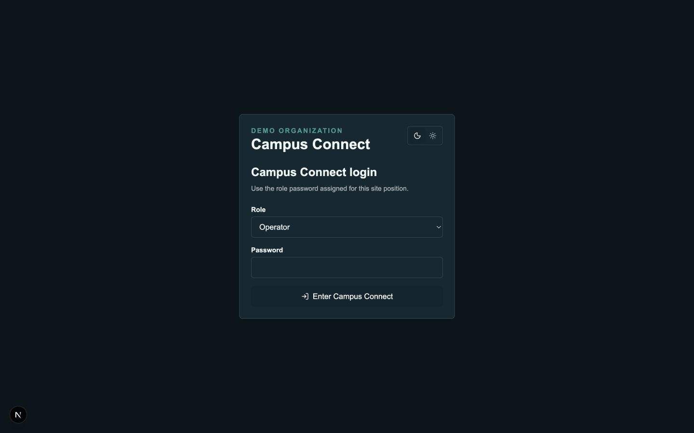
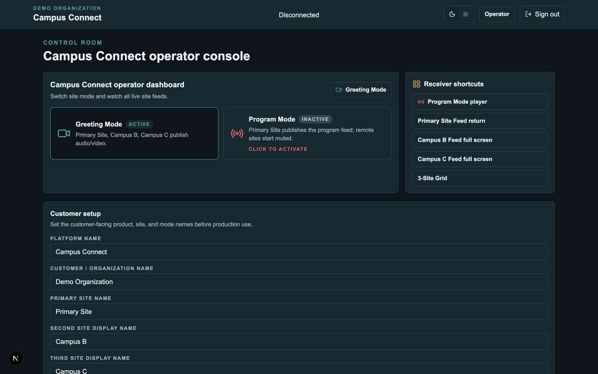
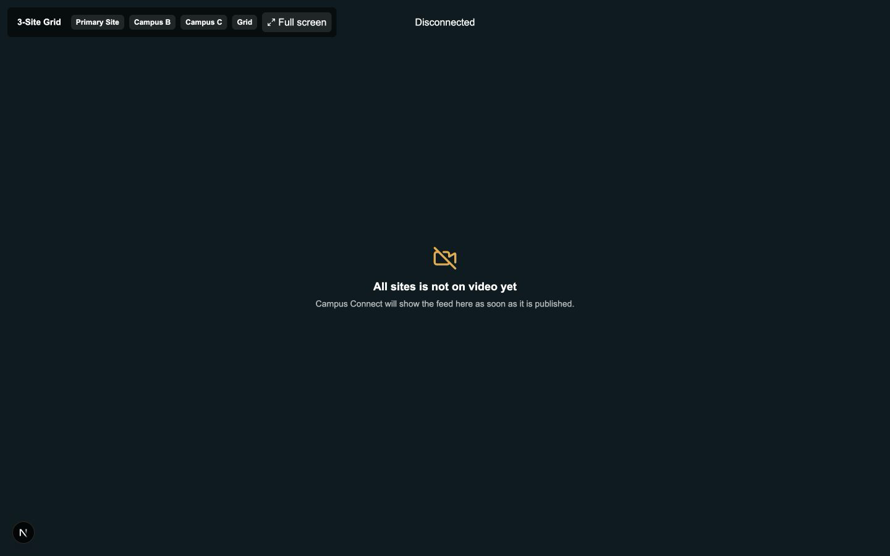

# Campus Connect

Production-oriented Docker Compose stack for running a branded multi-site live video platform on one AWS EC2 host. The default deployment uses generic SaaS naming, and each customer can set the platform name plus the three site names before going live.

## What is included

- Branded Next.js app at `app.example.com`
- Browser-based near real-time greeting mode using the RTC media server
- Program playback mode using SRT ingest and LL-HLS/WebRTC-capable stream relay playback
- Redis, coturn, nginx reverse proxy, HTTPS, rate limiting, and monitoring IP restriction
- Prometheus, Grafana, and Uptime Kuma
- Rust Capture Bridge companion for capture-card workflow planning and SRT handoff
- Deployment, backup, restore, security group, operator, volunteer, and troubleshooting docs

Start with the documentation index at [docs/README.md](docs/README.md).

## Screenshots

These captures are from a local demo run and do not represent a production deployment.

-  — Local demo sign-in screen.
-  — Local demo control room with site status cards.
-  — Local demo receiver view while feeds are disconnected.

## Modes

- Greeting Mode: Primary Site, Remote Site A, and Remote Site B publish audio/video to `campus-greeting`.
- Program Mode: the Primary Site publishes the final program feed to the stream relay as `default/broadcast/program`; remote sites receive the branded player at `/player/program`.
- Intercom: out of scope for this version.

## First deployment

For local testing before AWS, including real local media servers, see [docs/LOCAL_TESTING.md](docs/LOCAL_TESTING.md). For the 1080p production media target, see [docs/MEDIA_QUALITY.md](docs/MEDIA_QUALITY.md). For the Rust capture-card companion, see [docs/CAPTURE_BRIDGE.md](docs/CAPTURE_BRIDGE.md).

```bash
cp .env.example .env
npm --prefix campus-connect-web install
npm --prefix campus-connect-web run hash-password -- "replace with a strong role password"
sudo ./scripts/install.sh
./scripts/preflight.sh
./scripts/deploy.sh
```

Before `deploy.sh`, fill every `CHANGE_ME` value in `.env`, keep bcrypt hashes inside single quotes, point DNS to the Elastic IP, and obtain TLS certificates as described in [AWS_DEPLOYMENT.md](docs/AWS_DEPLOYMENT.md). Use `./scripts/deploy.sh` for production because it runs preflight checks and renders the `runtime/` media configs; do not start production with raw `docker compose up`.

After login as admin or operator, use **Customer setup** on `/operator` to set:

- Platform name
- Customer / organization name
- Primary site name
- Remote site A name
- Remote site B name
- First mode name
- Second mode name

## Key URLs

- App: `https://app.example.com`
- RTC signaling: `wss://rtc.example.com`
- TURN: `turn.example.com:3478/udp`, `turn.example.com:5349/tcp`
- Program playback: `https://stream.example.com/broadcast/program/llhls.m3u8`
- Monitoring: `https://monitor.example.com/grafana/` and `/uptime/`

## Stream names

- `default/broadcast/program`
- `default/broadcast/backup`
- `default/broadcast/test`

OBS/SRT example:

```text
srt://stream.example.com:9999?streamid=default/broadcast/program
```

## Compliance

The wrapper app in this repository is MIT licensed. The stream relay uses an upstream AGPLv3 media relay image; see [STREAM_RELAY_AGPL_NOTICE.md](docs/STREAM_RELAY_AGPL_NOTICE.md).
