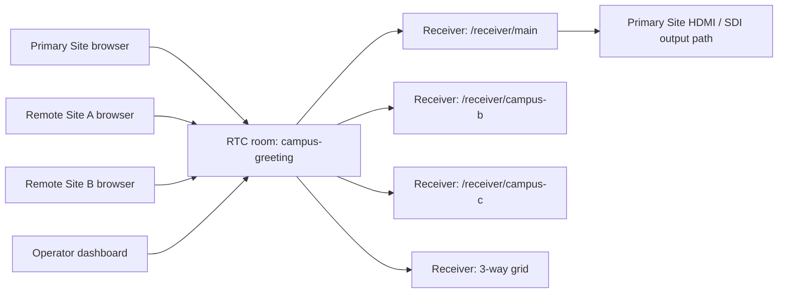
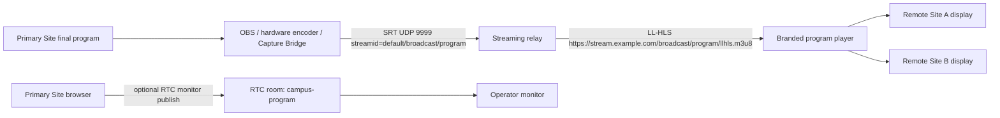

# Signal Flow

## Greeting Mode

## Program Mode

## Rooms

- `campus-greeting`: all three sites publish and subscribe.
- `campus-program`: Primary Site can publish; remote sites subscribe only.
- `campus-backstage`: reserved for future production workflows.
